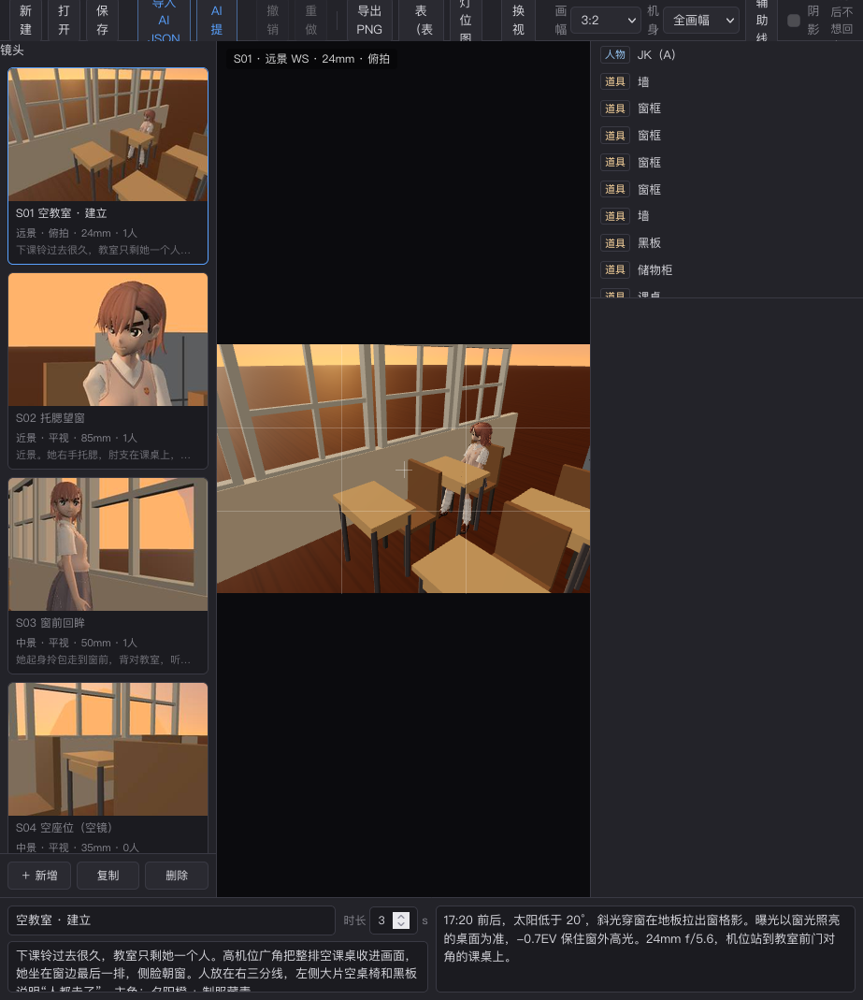
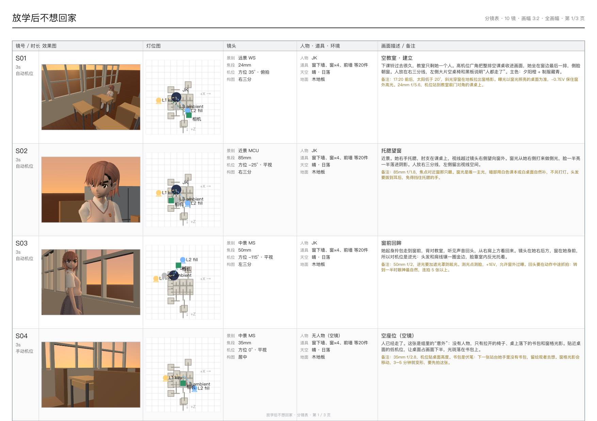

# Storyboard Studio · 分镜生成器

**JSON-first 的 3D 分镜工具。** 让 AI 写结构化分镜（机位、姿势、灯光、天气、地面），在浏览器里实时预览，再导出图片分镜表、CSV 或灯位图。





## 特性

- **唯一数据源是 JSON**：人物、道具、机位、灯光、环境全部语义化描述，不用手写坐标矩阵。
- **语义化机位**：景别（ECU–EWS）、等效焦段、方位角、俯仰角、三分线构图，程序自动求解相机位置。
- **姿势系统**：21+ 预设（站/坐/跪/回眸/托腮/打电话…）+ 17 个关节的角度微调，程序化木偶与 GLB/PMX 骨骼模型共用同一套参数。
- **天空与地面**：10 种天空（晴白天/日落/蓝调/夜晚/阴/雨/雷雨/雪/雾/纯色）+ 10 种地面（木地板/瓷砖/草地/泥地/沙滩/雪地/沥青/城市街区/水面/工作室）。
- **灯光**：三点光、色温、强度、灯位 gizmo，支持阴影与灯位俯视图。
- **导出**：单镜 PNG、A4 逐行图片分镜表（效果图 + 灯位图 + 机位 + 人物道具环境 + 描述备注）、CSV（Excel/WPS 可编辑）、灯位图。
- **Agent Skill**：仓库自带 `skills/storyboard`，AI agent 可以直接按它写分镜、校验 JSON、安装工具。
- **三端可用**：macOS / Windows / Linux，只需要 Node.js 和一个支持 WebGL 的浏览器。

## 快速开始

要求 **Node.js >= 20.19**（推荐 22 LTS）。

```bash
git clone https://github.com/Ackermancxy/storyboard-studio.git
cd storyboard-studio
npm ci
npm run build
npm start
```

打开 **http://127.0.0.1:5219/**（必须用 `http://`）。

## 一键安装（应用 + skill）

```bash
node scripts/install.mjs
```

安装器会构建应用、把 `skills/storyboard` 安装到 `~/.claude/skills/storyboard`，并创建启动器：

- macOS / Linux：`~/.local/bin/storyboard`
- Windows：`%LOCALAPPDATA%\storyboard\storyboard.cmd`

常用参数：

```bash
node scripts/install.mjs --dry-run      # 预览
node scripts/install.mjs --skill-only   # 只更新 skill
node scripts/install.mjs --port 5300    # 换端口
```

详细的三端安装、模型接入和排错见 [`skills/storyboard/references/deploy.md`](skills/storyboard/references/deploy.md)。想直接交给另一个 agent 安装，复制 [`docs/INSTALL_PROMPT.md`](docs/INSTALL_PROMPT.md) 里的整段 prompt。

## 给 AI agent 用

`skills/storyboard/` 是标准 Agent Skill（`SKILL.md` + `references/` + `examples/`）。安装到 agent 的 skills 目录后，agent 会：

1. 按 `references/schema.md` 写 `.storyboard.json`；
2. 用 `references/validate.js` 零依赖校验；
3. 把文件放进 `~/Downloads`；
4. 按 `SKILL.md` 的部署章节在任意机器上安装并启动 3D 工具。

更新已安装版本、给系统加功能时该改哪些文件，见 [`skills/storyboard/references/updating.md`](skills/storyboard/references/updating.md)。

完整样板：[`skills/storyboard/examples/放学后不想回家.storyboard.json`](skills/storyboard/examples/放学后不想回家.storyboard.json)（10 镜，含教室日落、站台蓝调、踏切夜景）。

把 skill 交给 Claude Code：

```bash
node scripts/install.mjs --skill-only
```

或手动复制到 `~/.claude/skills/storyboard/`。

## 模型

仓库自带：

| id | 来源 | 说明 |
|---|---|---|
| `mikoto` | 程序化 | 女生木偶 |
| `man` / `child` | 程序化 | 男性 / 儿童木偶 |
| `xbot` | Mixamo / three.js 示例 | 测试用 GLB（约 2.8 MB） |

**第三方角色模型不随仓库分发。** 自己的 PMX/GLB 放进 `public/assets/models/`，再建 `public/assets/manifest.local.json` 覆盖或追加（该文件已被 `.gitignore` 忽略）：

```json
{
  "characters": [
    { "id": "hero", "name": "主角", "type": "gltf", "file": "models/hero.glb",
      "height": 1.8, "rotateY": 0, "boneMap": "mixamo" }
  ]
}
```

GLB 需要骨架；Mixamo 命名可直接用 `"boneMap": "mixamo"`。PMX 模型和贴图按原目录结构放。

## 常用命令

```bash
npm run dev      # 开发服务器（5199）
npm start        # 构建产物静态服务（5219）
npm run build    # tsc + vite build → dist/
npm run check    # 类型检查 + vitest
npm run setup    # 安装应用 + skill + 启动器
```

## 目录

```
src/                    应用源码（无框架，Vite + TypeScript + three.js）
  scene/environment.ts  天空/天气/地面预设
  export/               PNG / 图片分镜表 / CSV / 灯位图
  ui/                   工具栏、检查器、镜头列表、视口
skills/storyboard/      Agent Skill（schema、校验器、创作思路、样板、部署文档）
docs/                   设计/提示词/截图
tests/                  vitest
serve.mjs               零依赖静态服务（三端通用）
scripts/install.mjs     跨平台安装器
SPEC.md                 设计规格
```

## 技术

three.js 0.186 · Vite 8 · TypeScript 7 · lil-gui · vitest。无后端、无数据库；构建后是一组静态文件。

## 许可

[MIT](LICENSE)。第三方依赖各自遵循其许可证；`Xbot.glb` 为 Mixamo 示例资产，仅用于演示，可自行删除。第三方角色模型（如有）请遵守其原作者许可，不要提交到公开仓库。
